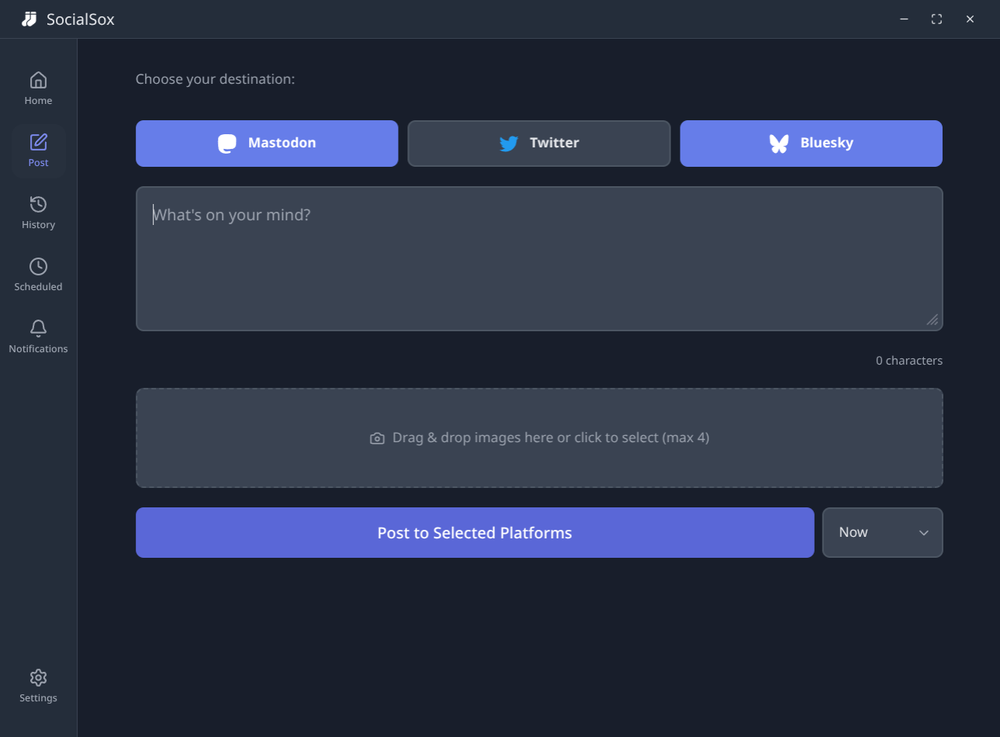
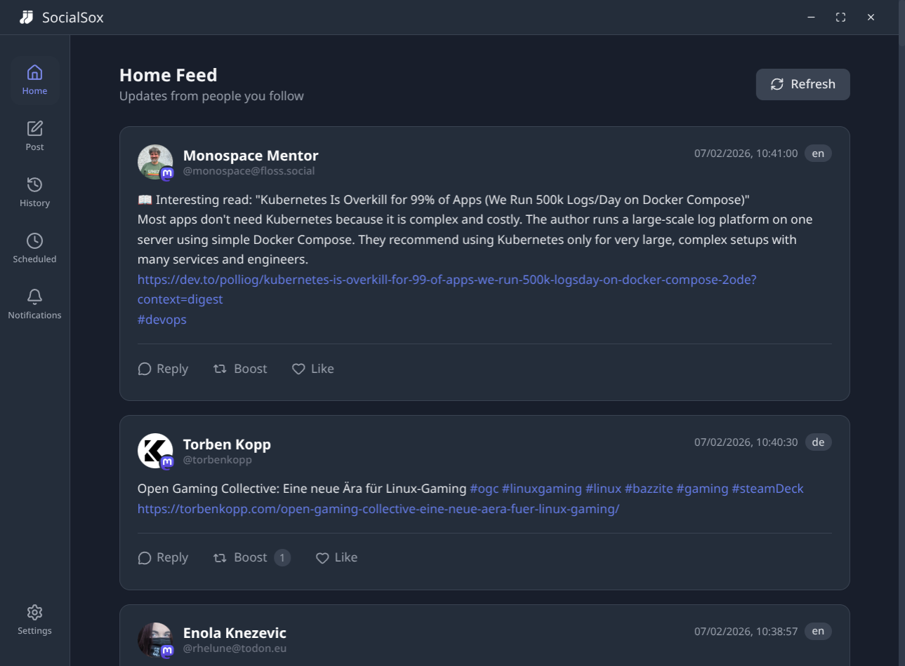
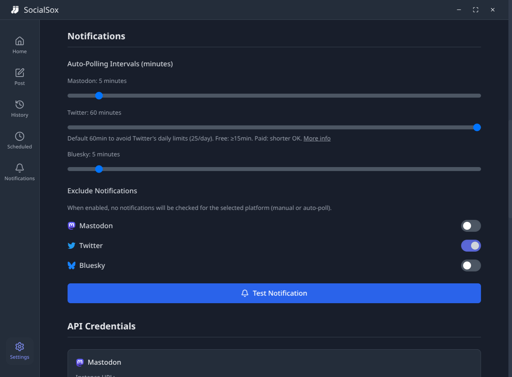

#  SocialSox

> [!WARNING]
> ## 🪦 Archived — no longer maintained (October 2026)
>
> **X killed the cheap write path this app was built on, so posting via X now fails with `✗ Twitter: credits depleted`.**
>
> | Date | Change |
> | :- | :- |
> | **Feb 6, 2026** | [X API Pay-Per-Use](https://docs.x.com/x-api/getting-started/pricing) launched — prepaid credits replace tiered plans, tracked per request in a new [developer console](https://console.x.com) |
> | **Feb 23, 2026** | [Programmatic replies restricted](https://docs.x.com/changelog) — replies via `POST /2/tweets` are only allowed when the original post's author has "summoned" you (self-serve tiers) |
> | **Apr 20, 2026** | [Write pricing changed](https://docs.x.com/x-api/fundamentals/post-cap) — `POST /2/tweets` is **$0.015/request**, **$0.20** if the post contains a URL; like/follow/quote-post endpoints removed from self-serve tiers |
>
> With a zero (or negative) credit balance, every request is rejected — including the config test, which is itself a billed `v2.me()` read. There is no free path left for a hobby crossposter, and chasing a moving, per-request-billed target isn't worth the maintenance. This repo is archived as-is: read-only, no issues or PRs actioned.
>
> **Still fine:** the Mastodon and Bluesky integrations have no such constraints and work as before. Fork it and delete `postToTwitter`/`replyToTwitter` from `main.js` if you want a maintained crossposter, or use [Postiz](https://github.com/gitroomhq/postiz-app) for a full-featured one.

A cross-platform desktop app for posting to Mastodon, X, and Bluesky—separately or all at once.

## Why SocialSox?

Modern social media is a fragmented mess. Reaching your audience across Mastodon, Bluesky, and X usually requires over-engineered SaaS subscriptions or complex self-hosted setups.

SocialSox is a focused, free alternative. It’s a local desktop app designed for one thing: getting your message onto every platform without the friction.

## Features

**Cross-Platform Posting**
- 📝 Post to Mastodon, X (Twitter), and Bluesky simultaneously
- 🖼️ Multiple image uploads with drag-and-drop reordering
- 📜 View posting history with delivery status tracking

**Social Feed**
- 🏠 Browse aggregated home feed from connected accounts
- 🔄 Infinite scroll with configurable platform mix
- 🏷️ Explore hashtags and user profiles
- ❤️ Like, boost, reply, and moderate directly from feed

**Scheduling & Sync**
- ⏰ Schedule posts for future publication (only when app running)
- 🔄 Automatic data synchronization (via sync folder)
- 📅 Drag-and-drop scheduled post management

### Message Composition


### Social Feed


### Settings & Credentials


## Project Notes

> [!NOTE]
> **This is a small focused vanilla JavaScript project with Tailwind and Lucide Icons** built for a simple need. [Read the blog post about how and why I built it](https://andreklein.net/i-built-my-own-damn-crossposter-because-2025-social-media-is-a-fragmented-hellscape/). It may benefit from refactoring to React/TypeScript in the future.

> [!TIP]
> **Minimalist by design** - I have no plans to turn this into a super-app with endless features. For more advanced social media management tools, check out [Postiz](https://github.com/gitroomhq/postiz-app).

> [!IMPORTANT]
> **Current implementation details:**
> - Tailwind CSS and Lucide icons are bundled with the app
> - Only essential Lucide icons are imported to minimize bundle size
> - Tested on Linux (Arch CachyOS), MacOS (Tahoe) and Windows 11

## Project Structure

The application follows a modular architecture to keep code organized and maintainable. The core functionality is split into separate modules located in the `src/modules/` directory:

```
src/
├── modules/
│   ├── ai.js               # AI-powered message optimization
│   ├── history.js          # Handles posting history and status tracking
│   ├── home/
│   │   ├── actions.js      # Home tab actions
│   │   ├── api.js          # Home tab API calls
│   │   ├── index.js        # Home tab main logic
│   │   └── render.js       # Home tab rendering
│   ├── icons.js            # Icon utilities
│   ├── imageUpload.js      # Manages image upload functionality
│   ├── notifications.js    # Handles platform notifications
│   ├── platforms.js        # Contains platform-specific API integrations
│   ├── resize.js           # Window resizing utilities
│   ├── scheduled.js        # Scheduled posts management
│   ├── stats.js            # Statistics and analytics
│   ├── storage.js          # Manages secure credential storage
│   ├── sync.js             # Data synchronization
│   └── ui.js               # UI-related utilities and helpers
```

This modular approach allows for easy maintenance and future extensions. For detailed coding guidelines and module conventions, see [AGENTS.md](AGENTS.md).

## Quick Start

### Option 1: Run from Source (Developers)

```bash
npm install
npm run dev
```

This starts the Vite dev server with hot-reload and automatically launches the Electron app for development.

### Option 2: Build Distributable Packages

```bash
npm run build
```

This creates platform-specific packages in the `dist/` folder:
- **Linux**: `.AppImage` file
- **macOS**: `.dmg` file  
- **Windows**: `.exe` installer

## Setup

Use the **Settings** tab to configure your API credentials. They're encrypted locally using Electron's safeStorage for security.

### Get Your API Credentials

#### Mastodon

1. Log in to your Mastodon instance (e.g., mastodon.social)
2. Go to Settings → Development → New Application
3. Give it a name (e.g., "SocialSox")
4. Select permissions: `read:accounts`, `read:blocks`, `read:favourites`, `read:follows`, `read:mutes`, `read:notifications`, `read:statuses`, `write:blocks`, `write:favourites`, `write:follows`, `write:media`, `write:mutes`, `write:statuses`
5. Click "Submit"
6. Copy your **instance URL** (just the domain like `https://mastodon.social`, NOT your profile URL)
7. Copy your **access token** from the application page

#### Bluesky

1. Log in to Bluesky
2. Go to Settings → App Passwords
3. Create a new app password
4. Use your handle (e.g., `username.bsky.social`) and the app password

#### X (aka Twitter)

1. Go to [X Developer Portal](https://developer.X.com/en/portal/dashboard)
2. Create a project and app (or use existing)
3. **Configure OAuth 1.0a permissions:**
   - Click on your app → **Settings** tab → "User authentication settings"
   - Click **"Set up"** or **"Edit"**
   - Enable **OAuth 1.0a** (choose "Web App, Automated App or Bot")
   - Set **App permissions** to **"Read and Write"**
   - Add any valid URL for Callback/Website (your GitHub repo works fine—these won't be used but X requires them)
   - Click **Save**
4. Go to **"Keys and Tokens"** tab
5. **Regenerate** your Access Token and Access Token Secret (important after changing permissions!)
6. Copy all 4 credentials:
   - **API Key** (also called Consumer Key)
   - **API Secret** (also called Consumer Secret)
   - **Access Token** (newly regenerated)
   - **Access Token Secret** (newly regenerated)

#### Grok AI (for Message Optimization)

1. Go to [x.ai](https://x.ai) and sign up for an account
2. Navigate to your API keys section
3. Create a new API key
4. Copy the API key and paste it in the Settings tab under "Grok API Key"

### Test Credentials & Post

Use the "Test Configuration" buttons in Settings to conveniently verify your credentials are working correctly.

**Portability**: Use the "📤 Export Credentials" button to save your credentials to a JSON file for backup or transfer to another device. Use "📥 Import Credentials" to load them back.

Switch to the **Post** tab to:
- Select platforms to post to
- Type your message (with character counter)
- Upload images (drag & drop or click, max 4)
- Reorder images by dragging them
- Click "Post to Selected Platforms"!

Check the **History** tab to view your past posts and their status.

## Security Notes

> [!NOTE]
> **Security Features:**
> - ✅ Everything runs locally. No external servers touch your data except the social media APIs themselves.
> - ✅ Credentials are encrypted using Electron's safeStorage (OS-level encryption via Keychain, DPAPI, or Libsecret).

> [!WARNING]
> **Encryption Fallback:**
> - If your OS does not have a secure store (like a keyring) configured, Electron may fall back to basic_text encryption. In this scenario, your credentials are only as secure as your file system permissions.
> - Always use a system-level login password to ensure safeStorage is actually "safe."

For security-related concerns, please see our [Security Policy](SECURITY.md).

## Limitations

> [!CAUTION]
> **Current Limitations:**
> - Maximum 4 images per post (platform API limits)
> - No thread/reply support
> - Character limits: X 280 chars, Mastodon 500+ (varies by instance), Bluesky 300 chars
> - Image size limit: 5MB per image
> - Image format support: PNG, JPG, GIF, WebP

## Troubleshooting

**App won't start or icons don't load**: Try running with debug console: `DEBUG=1 ./SocialSox.exe` (Windows) or `DEBUG=1 ./SocialSox` (Linux/Mac) to see error messages.

**Having issues with notifications, settings, or credentials?** Use the red "CLEAR ALL DATA" button in Settings for a complete reset - it wipes everything for a fresh start!

> [!IMPORTANT]
> **X Errors**:
> - **"oauth1 app permissions" error**: Your app isn't configured correctly
>   1. Go to your app's **Settings** → "User authentication settings"
>   2. Enable **OAuth 1.0a** with **"Read and Write"** permissions
>   3. Go to **"Keys and Tokens"** tab
>   4. **Regenerate** your Access Token and Access Token Secret (critical!)
>   5. Use the new tokens in SocialSox
> - Make sure you have all 4 credentials entered correctly
> - Old tokens won't work after changing permissions - you must regenerate them

> [!TIP]
> **Common Configuration Issues**:
> - **Instance URL Errors**: Use only the domain (e.g., `https://mastodon.social`), not your profile URL
> - **Mastodon Errors**: Make sure your instance URL is correct and includes `https://`
> - **Bluesky Errors**: Use your full handle including the domain (e.g., `user.bsky.social`)
> - **Image Upload Issues**: Ensure each image is under 5MB and in a supported format (PNG, JPG, GIF, WebP)
> - **Image Order**: Drag and drop images to reorder them - the order in the preview is the order they'll appear in your post

## Data Storage & Clearing Saved Data

SocialSox stores your data locally on your computer. Here's where to find and manage it:

### Windows
**Location**: `%APPDATA%\socialsox\`  
**Full path**: `C:\Users\[YourUsername]\AppData\Roaming\socialsox\`

### macOS
**Location**: `~/Library/Application Support/socialsox/`

### Linux
**Location**: `~/.config/socialsox/`

### Files Stored
- `notifications.json` - Cached notifications from platforms
- `history.json` - Your posting history and status tracking
- `window-config.json` - Window position and size preferences

### Clearing Data Manually
If you need to clear data manually (or the in-app "Clear All Data" button doesn't work):
1. Close SocialSox completely
2. Navigate to the folder above for your platform
3. Delete the files you want to clear:
   - Delete `notifications.json` to clear notification cache
   - Delete `history.json` to clear posting history
   - Delete `window-config.json` to reset window preferences
4. Restart SocialSox

> [!NOTE]
> Your encrypted API credentials are stored separately using your operating system's secure storage and won't be in these folders.

## Development

### Prerequisites

- Node.js 18+
- npm or yarn

### Setup

```bash
git clone https://github.com/burninc0de/socialsox.git
cd socialsox
npm install
```

### Testing

The project uses a custom test runner for integration tests focused on end-to-end functionality rather than unit tests. Tests mock external APIs to avoid hitting real social media endpoints.

### Testing Commands

- **Run all tests**: `npm test` - Executes the main test suite (currently sync tests)
- **Run tests in watch mode**: `npm run test:watch` - Runs tests with file watching using nodemon
- **Run a single test file**: `node test/sync.test.js` - Execute specific test files directly
- **Run specific test files**: `node test/sync-scenario.test.js`, `node test/sync-idempotent.test.js`

### Development Commands

- **Start development server**: `npm run dev` - Runs Vite dev server with hot-reload and launches Electron app
- **Build for production**: `npm run build` - Builds with Vite and creates distributable packages
- **Run built app**: `npm start` - Launches the built Electron application

### Debugging Built App

To run the built app with developer console:

- Windows: `DEBUG=1 && dist\win-unpacked\SocialSox.exe`
- Linux: `DEBUG=1 ./dist/linux-unpacked/SocialSox`
- macOS: `DEBUG=1 ./dist/mac/SocialSox.app/Contents/MacOS/SocialSox`

## License

This project is licensed under the MIT License - see the [LICENSE](LICENSE) file for details.

## Contributing

Please read [CONTRIBUTING.md](CONTRIBUTING.md) for details on the process for submitting pull requests.
